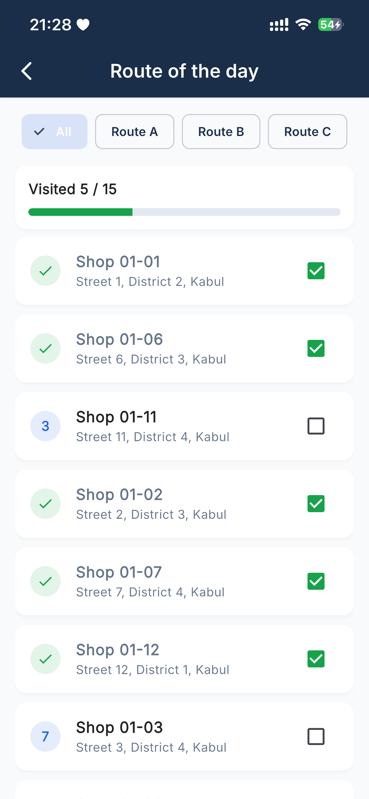
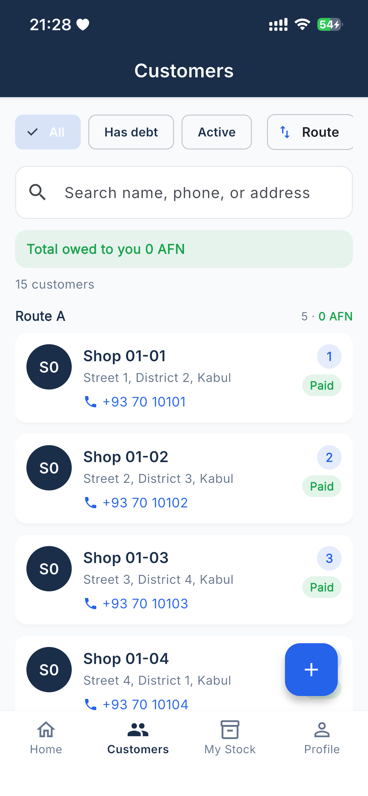
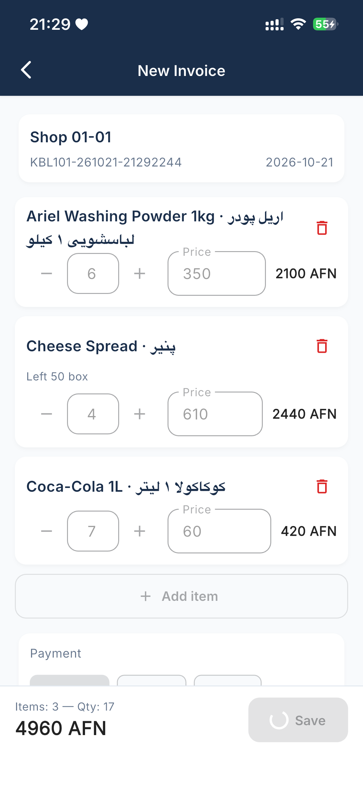
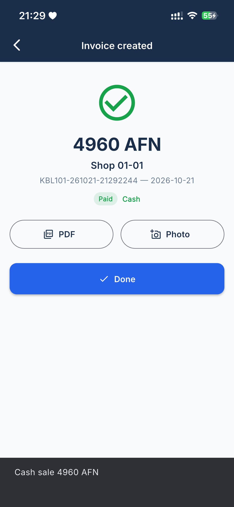
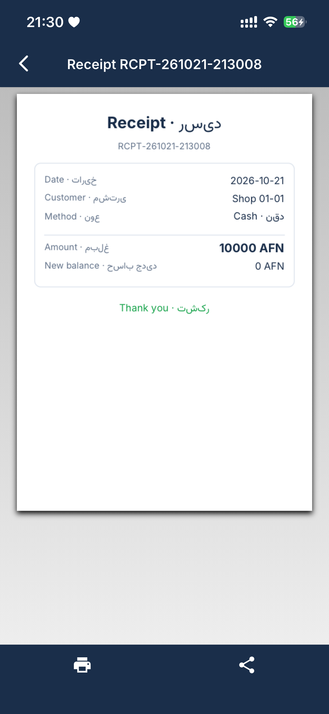
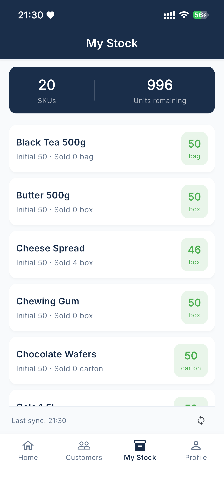
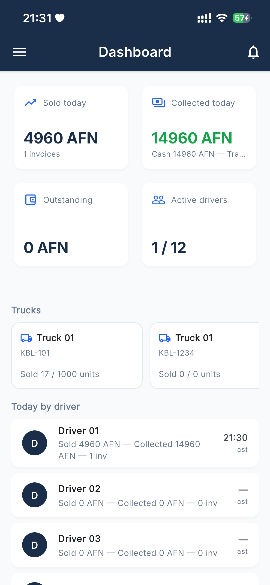
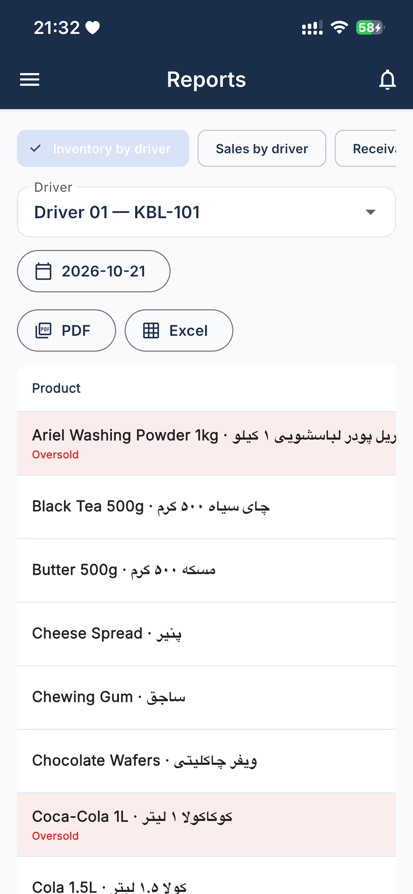
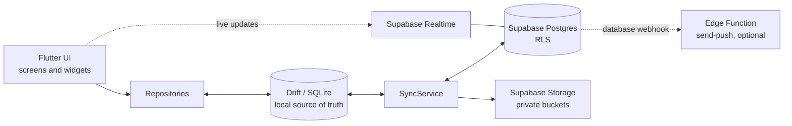

# Van Sales

An offline-first Flutter app for van sales drivers and the back office of a small distributor, in English and Dari (right-to-left).

## Screenshots

| Route of the day | Customers | New invoice | Invoice created |
|---|---|---|---|
|  |  |  |  |

| Receipt PDF | Truck stock | Office dashboard | Office reports |
|---|---|---|---|
|  |  |  |  |

## Problem and context

A distribution company runs 12 delivery trucks. Each driver visits 15 to 20 shops per trip: they sell from the stock on the truck, print or share an invoice, take cash or put the amount on the shop's credit, and sometimes collect old debt. Mobile coverage on the road is patchy, so the app cannot depend on a connection. Every driver action has to work offline and reach the office later without losing or duplicating data.

The office needs the opposite view: what each truck carries, what was sold and collected today, who owes money and for how long, how much cash a driver still has to hand in, and where the trucks are right now.

Built as a commissioned project for a distribution company; client details have been anonymized.

## Project history

The app was built for a client in a private repository between April 2026 and August 2026.
The client's plans changed before rollout, so it was never deployed in production.
This public repository is a cleaned-up copy: client details and credentials were removed,
which is why the history starts with a single initial commit.

## Features

### Driver

- Route of the day: ordered customer list with visit marks.
- Customers: search, filters (has debt, active, by route), add or edit a shop with phone, address, credit limit and two store photos.
- New invoice: product picker with remaining-stock badges, editable quantity and price, cash / partial / credit payment, credit-limit warning, optional invoice photo.
- Payments against a single invoice or against the account (allocated to the oldest open invoices first).
- Invoice and receipt PDFs generated on the device, printable or shareable, bilingual by design.
- Truck stock: initial, sold and remaining quantity per product.
- Day summary: sales split by payment type, collections, new debt, visited shops, PDF export.
- Opt-in location sharing while working.

### Office

- Dashboard with today's totals per driver and a live feed of new invoices (Supabase Realtime).
- Trucks: activate or deactivate, see the assigned driver and current stock, set initial stock.
- Product catalogue with categories, and customers across all drivers.
- Reports with PDF and Excel export: inventory by driver, sales by driver, receivables with aging buckets, driver liability (goods and money reconciliation, cash handover), company report with previous-period comparison.
- Live map of driver positions on OpenStreetMap tiles.

## Architecture



The UI only talks to repositories. Repositories write to the local Drift database first and mark rows as dirty. `SyncService` moves data between Drift and Supabase. Realtime is used by the office for the invoice feed and the live map.

## Offline sync

A sync runs on app start, when connectivity comes back, when the app returns to the foreground, every five minutes, and on the manual sync button. Only one sync runs at a time, and nothing runs while the device is offline.

Every syncable table has a `synced` flag. Local writes set it to `false`; a row is flagged `true` only after the server accepted it. The status bar shows how many rows are still waiting.

### Order of one run

1. **Photos.** Receipt, invoice and store photos taken offline are uploaded first, so the rows pushed in the next step already carry their storage paths. A failed upload is logged and retried next time; it never blocks the rest of the sync.
2. **Push, parents before children** (foreign-key safe): `truck_loads` → `truck_load_items` → `truck_initial_stock` → `invoices` → `invoice_items` → `payments` → `driver_settlements` → `products` → `customers`.
3. **Pull reference data:** `trucks` → `driver_profiles` → `categories` → `products` → `truck_initial_stock` → `customers` → `driver_settlements`. Categories come before products so `category_id` always resolves.

Customer edits and soft deletes are pushed before the pull, so an offline delete reaches the server instead of being overwritten by it. A customer is held back while it still has unsynced invoices or payments, so the office never sees a balance that refers to rows it has not received yet.

Child collections (`invoice_items`, `truck_load_items`) are mirrored per parent: the server set for that invoice or load is deleted and replaced with the full local set. A plain upsert would leave lines that were removed offline on the server.

### Conflict policy

| Data | Tables | Policy |
|---|---|---|
| Master data | `customers`, `products`, `categories`, `truck_initial_stock` | Last write wins by `updated_at` (server triggers keep it current). A local row with unsynced changes is never overwritten by a pull. |
| Transactional data | `invoices`, `invoice_items`, `payments`, `driver_settlements` | Append-only. A pull never overwrites the server copy of a document; edits travel through their own push. |

The rules live in `lib/core/sync/sync_policy.dart` and are covered by unit tests.

### Errors

Each table is synced in its own guarded step with three attempts and exponential backoff (0.5 s, 1 s). A failure is recorded under the table name and the run continues with the next table, so one broken table does not stop the others. Rows that failed stay dirty and go out on the next run.

## Security

- **Row Level Security on every table.** Roles come from `driver_profiles.role`: `driver`, `office`, `admin`. A driver reads and writes only rows where `driver_id = auth.uid()`; office and admin go through the `is_office_or_admin()` helper.
- **Server-side totals.** `invoice_items.total` is a generated column (`quantity * unit_price`). The client never sends it, so a modified client cannot forge a line total.
- **Private storage.** The `load-receipts`, `customer-photos` and `invoice-photos` buckets are private. The app stores object paths and creates short-lived signed URLs when it needs to show an image.
- **No keys in the repository.** The Supabase URL and publishable key are passed at build time with `--dart-define`. The service-role key is only used inside the Edge Function.

## Data model

| Table | Purpose |
|---|---|
| `driver_profiles` | One row per auth user: name, role, assigned truck |
| `trucks` | Plate number, name, active flag |
| `categories`, `products` | Catalogue with English and Dari names, SKU, unit, price |
| `truck_initial_stock` | Stock the office puts on each truck |
| `truck_loads`, `truck_load_items` | Legacy load requests with bill photo. Still part of the schema and sync; the current UI sets truck stock through `truck_initial_stock` instead. |
| `customers` | Shops with owner driver, route, credit limit, photos, soft delete |
| `invoices`, `invoice_items` | Sales documents; payment type and status |
| `payments` | Cash or transfer, linked to an invoice or to the account |
| `driver_settlements` | Cash handed in by drivers to the office |
| `driver_locations` | Last known position per driver for the live map |
| `device_tokens` | FCM tokens (only with push notifications enabled) |

## Tech stack

- Flutter, Dart 3
- Supabase: Postgres with RLS, Auth, Storage, Realtime, Edge Functions (Deno, TypeScript)
- Drift on SQLite for the local database
- go_router with role-based redirects
- `pdf` and `printing` for invoices, receipts and reports; `excel` for spreadsheets
- `flutter_map` with OpenStreetMap tiles, `geolocator`
- `connectivity_plus`, `image_picker`, `shared_preferences`
- `flutter_localizations` with ARB files (English and Dari)
- Optional: Firebase Cloud Messaging

## Getting started

Requirements: Flutter 3.27 or newer and a free Supabase project.

1. **Database.** In the Supabase SQL editor, run the files in `supabase/migrations/` in order: `0001` to `0016`, then `0018`. Skip `0017` unless you enable push notifications.
2. **Users.** In Authentication → Users, add two users with "Auto Confirm User" checked, choosing your own passwords:
   - `office@demo.local` with user metadata `{"full_name": "Office Admin", "role": "office"}`
   - `driver@demo.local` with user metadata `{"full_name": "Demo Driver", "role": "driver"}`

   A trigger creates their `driver_profiles` rows. Assign the driver a truck by setting `driver_profiles.truck_id` in the table editor.
3. **Optional test data.** `supabase/seed/seed_12_trucks.sql` creates 12 trucks, 12 drivers, products and customers. It reads the drivers' password from a session setting, so prepend this line when you run it:

   ```sql
   set seed.driver_password = 'choose-a-password';
   ```

4. **Run the app.**

   ```bash
   flutter pub get
   dart run build_runner build --delete-conflicting-outputs
   flutter run --dart-define=SUPABASE_URL=https://<project-ref>.supabase.co --dart-define=SUPABASE_ANON_KEY=<publishable-key>
   ```

   `flutter pub get` also generates the localization classes. `.env.example` lists the two values if you prefer to keep them in a local, git-ignored `.env`.

## Tests

```bash
flutter test
```

- **Sync policy:** last-write-wins decisions in both directions, dirty-row protection, time zones, storage URL normalization.
- **Repository flows** on an in-memory Drift database: cash, partial and credit sales, stock decrement, payment status transitions, FIFO allocation of account payments, soft delete, offline invoice creation, and reconciliation of the day summary and all office reports.
- **Invoice numbering:** format, padding, prefix sanitizing, status mapping.
- **Widgets:** login form validation, `SyncStatusBar` in idle, syncing and failed states, new invoice total recalculation, switching to Dari turns the app right-to-left.

The tests need no network and no Supabase project.

## Project structure

```text
lib/
├── main.dart                 app entry, router, role-based redirects
├── core/
│   ├── auth/                 auth service, router refresh
│   ├── constants/            build-time config and feature flags
│   ├── database/             Drift schema and generated code
│   ├── locale/               locale controller, l10n accessor
│   ├── repositories/         data access and report aggregation
│   ├── services/             storage, PDF, export, location, push, realtime
│   ├── sync/                 sync engine and conflict policy
│   ├── theme/
│   ├── utils/
│   └── widgets/              shared widgets (sync status bar)
├── features/
│   ├── auth/                 login
│   ├── customers/            customers, invoices, payments, route
│   ├── dashboard/            driver and office shells, day summary, profile
│   ├── inventory/            truck stock
│   └── office/               office tabs, reports, live map
└── l10n/                     app_en.arb, app_fa.arb
supabase/
├── migrations/               0001–0018
├── seed/                     optional 12-truck test data
└── functions/send-push/      Edge Function for push notifications
docs/                         user guide, QA checklist, iOS release, push setup
```

## Optional: push notifications

Push notifications are implemented but switched off with `AppConstants.kPushEnabled = false` in `lib/core/constants/app_constants.dart`. With the flag off, the app never initializes Firebase, so it builds and runs without `google-services.json` or `GoogleService-Info.plist`; the office still gets new invoices through the in-app Realtime feed. The Android Google Services plugin is applied only when `android/app/google-services.json` exists.

To turn push on:

1. Create a Firebase project, add the Android app (`dev.maksimenko.vansales`) and the iOS app, and place `google-services.json` in `android/app/` and `GoogleService-Info.plist` in `ios/Runner/`. Both files are git-ignored.
2. On iOS, add the Push Notifications capability and an APNs key in Firebase.
3. Apply migration `0017_device_tokens.sql`.
4. Deploy `supabase/functions/send-push`, store the FCM key as a function secret, and add database webhooks for `invoices`, `driver_settlements` and `truck_initial_stock`.
5. Set `kPushEnabled = true` and rebuild.

The full checklist is in [docs/push-reactivation.md](docs/push-reactivation.md).

## License

[MIT](LICENSE)
